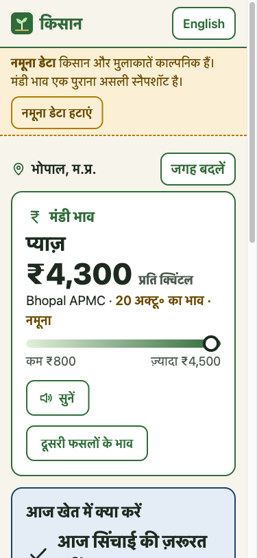
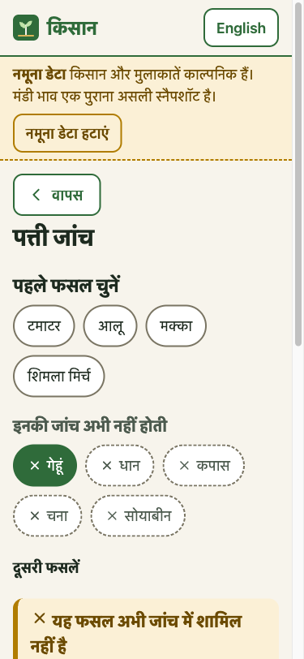
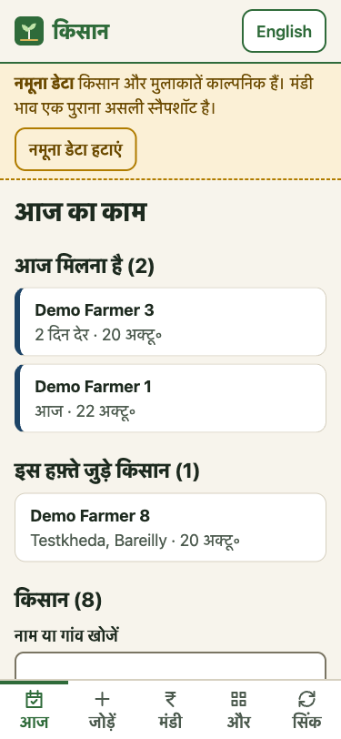
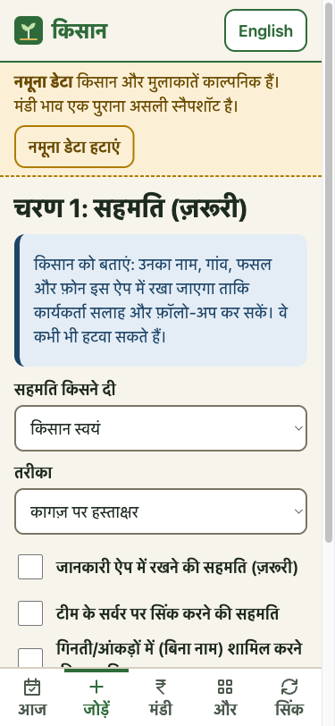

# Kisan

An offline-first web app for farmers and the field workers who visit them in Madhya Pradesh, Chhattisgarh, Vidarbha, Gujarat and Uttar Pradesh. Hindi by default, English one tap away. Works on low-cost Android phones in the browser and installs to the home screen.

**Live demo:** https://shriniwas2412.github.io/kisan/ (opens in demo mode; no server, no sign-in).

There are two views:

- **Farmer (no login):** the price of *their* crop in Hindi (from one real, dated Agmarknet row), "आज खेत में क्या करें" (today's irrigation advice in one sentence, plus the next 4 days with rain in words), a leaf check, scheme cards, sowing times, read-aloud in Hindi, and an "About & limits" page.
- **Field worker:** a "Today" list (follow-ups due, farmers added this week, what is not yet synced), onboarding with a **mandatory consent step**, visit timeline per farmer, paste-from-spreadsheet import (checked against the database schema), manual mandi prices, export to CSV/JSON, and sync status. Everything works offline on the phone; signing in is only needed to sync with the team server.

| Farmer home | Leaf check refuses wheat | Field worker's day | Consent first |
|---|---|---|---|
|  |  |  |  |

Screenshots are from the demo build at 375×812 with demo data (made-up farmers; the price is a real, dated Agmarknet row).

This replaces my earlier prototypes. The old Flutter app was a UI mock-up: its "disease results" were fixed sample text and it had no model inside. This app runs a real classifier and real weather maths, and it says plainly where they stop being useful.

## What it does, and its limits

### Mandi rates

- Source: data.gov.in, "Current Daily Price of Various Commodities from Various Markets (Mandi)" (Agmarknet), resource `9ef84268-d588-465a-a308-a864a43d0070`. Prices are in Rs./Quintal as Agmarknet publishes them.
- The server proxies the API (it keeps the key off the phone and avoids CORS). It caches each query in D1 for 6 hours.
- If Agmarknet does not answer, the app shows the last good snapshot, marked as old, with its date. If there is no snapshot, it says **"आज का भाव उपलब्ध नहीं"** (today's rate is not available). It never makes up, interpolates or carries a price forward as if it were today's. Tests: `server/test/mandi.test.ts`.
- The phone also keeps its last answer, so with no internet it still shows the saved rates with the date they were saved.
- Commodity names come from real responses, not a guessed list. The farmer view shows them in Hindi (प्याज़ for "Onion") with the Agmarknet string beside it; the field-worker view keeps Agmarknet's wording.
- **"My crop" price.** A farmer's crop is linked only to Agmarknet names actually seen from the API (`OBSERVED_COMMODITIES` in `web/src/core/farmView.ts`; gram, cotton, potato and sugarcane have none yet, so none is guessed). The home screen shows the newest row for the first of the farmer's crops that has one, with its modal price per quintal, market, date and a low–modal–high bar drawn from that same row. If the report has no price for their crops it says so; it never shows another crop's price as theirs (tested in `farmView.test.ts`).
- Field workers can note a price they saw at the mandi. Those prices carry a separate "seen by field worker" badge and are never mixed with Agmarknet rows.
- **Status, verified on 2026-10-19/20:** three live calls in total through the proxy with the portal's public sample key (one probe for Madhya Pradesh/Bhopal on 2026-10-19, then Madhya Pradesh/Bhopal and Madhya Pradesh state-wide on 2026-10-20 for the demo snapshot) returned rows with the documented fields (`state, district, market, commodity, variety, grade, arrival_date, min_price, max_price, modal_price`). The sample key is limited; production needs your own free key from data.gov.in as the `DATA_GOV_IN_KEY` secret. Tests use synthetic fixtures, never live calls.
- District names for the preset places are sent as filters. If Agmarknet spells a district differently, the API returns nothing and the app says "not available" rather than guessing.

### Leaf check

The model is the MobileNetV3-Small classifier from my kisan-agent project, trained on PlantDoc (28 classes) and exported to ONNX (6.2 MB file in `web/public/model/`). It runs in the browser with onnxruntime-web, which is loaded only when a check is run.

Measured on the PlantDoc test split (236 images), from the ONNX evaluation report in `web/src/core/data/leaf_eval.json`:

| | |
|---|---|
| Top-1 accuracy | 42.8% |
| Top-3 accuracy | 77.1% |
| Photos where confidence ≥ 0.6 | 28.8% |
| Accuracy on those | 76.5% |

`web/src/core/leaf.test.ts` checks that the numbers shown in the app come from that report and that this README states them. (The per-photo predictions were not saved when the report was made, so the test checks against the report, it does not re-run the evaluation.)

Sample sizes: 236 test photos (top-1 is about ±6 points at 95%), and the 76.5% is 52 of 68 confident photos (about ±10 points), by the normal approximation; `leaf.test.ts` derives both from the report. The 0.7 threshold row in the report (73.5%) is a little lower than the 0.6 row, which fits that small-sample noise. The evaluation script is `training/eval_onnx.py` in kisan-agent.

How the app uses it:

- **Crop first.** The picker lists the region's crops first (tomato, potato, maize, capsicum), then, under "not checked yet" with a ✕, wheat, paddy, cotton, gram and soybean, then the other PlantDoc crops folded away. The model only knows apple, bell pepper, blueberry, cherry, corn, grape, peach, potato, raspberry, squash, strawberry, tomato, and a healthy soybean leaf. There are **no wheat, rice, cotton, gram (chana) or soybean disease classes**, and those are the main crops where this app is meant to be used. For those crops the app says "not supported yet" and does not run the model.
- It shows the top 3 as **possible**, never as a diagnosis, with Hindi names for the 28 labels (the model's English label stays beside them). The Hindi disease names are my own translations and have not been checked by a KVK or plant pathologist. Below 0.6 confidence it says it is not sure. If its best guess is a different plant than the one picked, it asks for a clearer photo.
- The limits card leads with "the first guess is right about 4 times in 10" (from top-1 42.8%) and keeps the exact numbers below it.
- Every result ends with "show the leaf to your KVK or agri officer". The advice text is generic and never gives a spray or dose.
- PlantDoc is web-scraped photos. The model has **not** been tested on fields in MP or anywhere else in India.
- Preprocessing matches training exactly (short side to 256, centre crop 224, ImageNet normalisation). The browser's canvas resize changes pixels enough to flip answers, so `leaf.ts` ports Pillow's bilinear resample; a test checks it against Pillow output byte for byte.

### Irrigation and weather

- Weather and reference evapotranspiration (ET₀, FAO-56 Penman-Monteith) come from Open-Meteo (free, no key), cached on the phone for 3 hours.
- Advice is a daily soil-water balance after FAO-56:
  - water used each day since the last watering = Kc × ET₀ − useful rain, never below zero in total;
  - readily available water RAW = p × TAW × root depth, and the advice is "irrigate" once the water used reaches RAW, unless the useful rain forecast for the next 2 days covers it ("wait");
  - otherwise it estimates the days left from the average Kc × ET₀ of the next 3 forecast days.
- Where each number comes from (all checked in `web/src/core/irrigation.test.ts` against the rows copied into `web/src/core/data/fao56_rows.json`):
  - Kc: FAO-56 Table 12, from the named row per crop (wheat uses "Spring Wheat"); where a range is printed, the higher value.
  - Root depth: Table 22; where a range is printed, the lower value, so the advice errs towards watering.
  - p (depletion fraction): Table 22 for each crop, e.g. onion 0.30, potato 0.35, tomato 0.40, wheat 0.55, cotton 0.65. Not adjusted for the day's ETc.
  - TAW: the midpoint of the Table 19 range for sand, loam and clay (80, 155, 160 mm per metre).
  - Useful rain: 0.8 × the day's rain when it is above 2 mm, otherwise zero. This is the app's own rule of thumb, **not** an FAO-56 method.
- Paddy gets a keep-standing-water message.
- **On screen:** the result is one sentence first ("आज सिंचाई की ज़रूरत नहीं · लगभग 10 दिन बाद अगली सिंचाई"), with the numbers under "how it was worked out". The farmer answers "when did you last water?" with plain choices (today, yesterday, 2–3 days ago counted as 3, a week ago, or a date). The farmer home repeats today's advice and shows the next 4 days as आज / कल / weekday with rain in words, using IMD's 24-hour categories (very light up to 2.4 mm, light 2.5–15.5, moderate 15.6–64.4, heavy 64.5–115.5, very heavy 115.6–204.4, extremely heavy 204.5+; from IMD bulletin footnotes, e.g. https://mausam.imd.gov.in/hyderabad/mcdata/tgfcst.pdf, checked 2026-10-22; tested in `farmView.test.ts`).
- **Read aloud:** price, today's advice and the leaf result can be read out with the phone's own `speechSynthesis`, only if the phone has a Hindi voice; otherwise the button is replaced by a short note. The spoken text repeats what is on screen, including the date and "not today's price" for the demo snapshot. Checked in desktop Chrome on macOS (a Hindi voice was found); **not yet checked on an Android phone**.
- It is a rule of thumb. It ignores salinity, mulching and drip efficiency, and the app tells farmers to check soil moisture by hand first.

### Sowing times and schemes

- Sowing windows are static JSON (`web/src/core/data/crop_calendar.json`). Every entry has a source URL and the date it was checked; the app drops any entry without one (tested). Right now there are three entries (wheat, gram, soybean), each read from a Government of India Vikaspedia package-of-practices page on 2026-10-20. More crops need a source before they are added.
- Scheme cards: PM-KISAN, PMFBY, Soil Health Card, Kisan Credit Card and PM-KUSUM, each with its official link and the date it was checked. The text is a short summary of the official page. The app makes no eligibility claims and sends people to the official site or agriculture office.

### Farmer records, consent and sync

- A farmer cannot be saved without a consent record (who gave it, how, the date, and what it covers).
- **Sync needs its own consent.** The phone only sends a farmer, their consent, visits and leaf checks to the team server if the farmer agreed to sync (`scope_sync = 1`); otherwise they stay on that phone and the Sync screen counts them as "kept on this phone". The server also refuses a farmer, visit or leaf check unless a consent row with `scope_store = 1` and `scope_sync = 1` exists and is not withdrawn (tested in `server/test/sync.test.ts` and `web/src/core/syncScope.test.ts`).
- **Withdraw consent erases.** It marks the consent as withdrawn and deletes the farmer, their visits and leaf checks. On the phone the personal fields are cleared at once. On the server the rows become tombstones: the id, the links between rows and `deleted = 1` stay (so other phones learn about the deletion), and every personal column (name, phone, village, location, crops, notes, visit notes, leaf results) is cleared. Phones that pull the tombstone replace their copy with it. A withdrawal cannot be undone by any later push, and no new visit or leaf check is accepted for that farmer (tested). Tombstones (ids and stamps, no personal data) are kept with no expiry, so that a phone that has been offline for months still learns about the deletion.
- **Field worker's "Today" list:** follow-ups that are due or overdue (from the latest visit's `follow_up_on`), farmers added in the last 7 days, and a "not synced" badge on farmers with changes still on the phone, plus an offline banner. Built from the rows on the phone only (`web/src/core/today.ts`, tested).
- **Export:** the field worker can download the farmers as CSV (the onboarding template's columns) or every table as JSON. Deleted rows and sync stamps are left out, and cells starting with `=`, `+`, `-` or `@` get a leading `'` so a spreadsheet will not run them as formulas (`exporter.ts`, tested).
- Pasted spreadsheet rows use the same column names as the database. Every value is checked against the schema; bad rows are listed by line with the reason and are never "fixed" automatically. Farmers need a matching consent row in the same paste (or already on the phone).
- Sync is a CRDT: each record is a last-writer-wins map with hybrid logical clock stamps per field, so two phones editing different fields of the same farmer offline both keep their changes, whatever order they sync in (randomised test merges 5 phones in 30 orders). The server merges the same way and uses its own sequence number as the pull cursor. Stamps more than a day in the future (a phone with a wrong clock) are refused.
- Auth: email + password, PBKDF2-SHA256 (100,000 iterations, the Workers maximum) and a signed JWT in an httpOnly, SameSite=Lax cookie. Roles are `field_worker` and `admin`. There is **no open sign-up**: the operator creates the first admin with `npm run create-admin` (below), and only an admin can add accounts. The server refuses to run with an empty, short, low-variety or placeholder `JWT_SECRET`. The plain-Node dev server listens on 127.0.0.1 unless `HOST` is set.
- Rate limits: within 15 minutes, 5 failed sign-ins for one email, or 20 failures from one address, make further attempts wait (HTTP 429), even with the right password. Attempts are stored in D1 with a keyed hash of the address, never the address itself. Unknown emails take about as long to refuse as wrong passwords. (Tests: `server/test/auth.test.ts`.)

## Demo mode

The hosted demo (and any build made with `VITE_DEMO=1`) opens with **demo data** and a "नमूना डेटा / Demo data" banner on every screen.

- **Farmers, visits and leaf checks are synthetic:** a seeded generator (`web/src/core/demo.ts`, seed 2412) makes 48 farmers named "Demo Farmer 1" to "Demo Farmer 48" across real districts (Bhopal, Sehore, Indore, Raipur, Amravati, Bareilly, Ahmedabad, Rajkot, Anand) in invented villages like "Testpur", each with a consent record, one to three visits with irrigation and leaf notes (marked "नमूना / demo"), and some leaf-check results shaped like the model's output. They are not field results. The demo lives in its own local database (`kisan-demo`), so it never mixes with real records, and "clear demo" deletes it. No phone numbers. Demo rows have ids starting with `DEMO-` and are never sent to a server. To show a field worker's day, Demo Farmer 1's follow-up is due on the day the demo loads, Demo Farmer 3's is two days overdue, and Demo Farmer 8 joined two days earlier.
- The farmer view opens on the home screen as a demo farmer in Bhopal growing wheat and onion, last watered 5 days before the demo loaded. The Bhopal snapshot has an onion row but no wheat row, so the home shows onion.
- **Mandi prices are real but old.** The demo has no server, so it shows 11 Agmarknet rows (Madhya Pradesh) fetched once through the proxy on 2026-10-20 and saved in `web/public/demo/mandi-snapshot-2026-10-20.json` with the source and fetch date. The app labels them "demo snapshot (not today's price)" with the date and a link to the dataset. No price is made up.
- Weather and irrigation advice stay live (Open-Meteo). The leaf check runs as usual.
- "Clear demo data" removes every demo row and keeps anything you added yourself. "Try demo" on the first screen loads it again.

Tests: `web/src/core/demo.test.ts` (demo rows are valid and have consent, load/clear touch only demo rows, the snapshot is dated and sourced, the label).

## Run it locally

Node 23.6 or newer (TypeScript runs natively in Node; tests use `node --test`).

```bash
cd server && npm install
cp .dev.vars.example .dev.vars   # then set JWT_SECRET to the output of: npm run gen-secret
cd ../web && npm install && npm run build
cd ../server && npm run dev      # API + built app on http://localhost:8787
```

`npm run dev` in `server/` runs the same Hono app on plain Node with a local SQLite file, so no wrangler or Docker is needed on a small machine. For live editing of the UI, run `npm run dev` in `web/` instead (Vite proxies `/api` to port 8787).

Demo accounts for the local server: put `DEMO_ADMIN_EMAIL`, `DEMO_WORKER_EMAIL` and `DEMO_PASSWORD` (12+ characters, your own) in `server/.dev.vars`, then:

```bash
cd server && npm run seed:demo   # creates a demo admin and a demo field worker in .local.sqlite
```

Sign in with either on the Sync tab. Change the password before showing it to anyone else. To create a real admin instead (local database, or `--sql` to print one INSERT for D1; only the password hash is printed):

```bash
cd server && ADMIN_NAME="Your Name" ADMIN_EMAIL=you@example.org ADMIN_PASSWORD='12+ characters' npm run create-admin
cd server && ADMIN_NAME="Your Name" ADMIN_EMAIL=you@example.org ADMIN_PASSWORD='12+ characters' npm run create-admin -- --sql
```

Tests:

```bash
cd web && npm test      # leaf, irrigation, mandi view, CSV import, calendar/schemes, CRDT, schema
cd server && npm test   # mandi proxy cache + stale fallback, auth, sync + consent rules
```

### Deploy (not done from here)

- Demo on GitHub Pages: `.github/workflows/pages.yml` runs the tests, builds `web` with `VITE_DEMO=1` and the repo name as the base path, and publishes it on every push to `main`. Turn it on once under Settings → Pages → Source: GitHub Actions. No secrets are needed.

- API: Cloudflare Workers + D1. `wrangler d1 create kisan`, put the id in `server/wrangler.toml`, `wrangler d1 migrations apply kisan`, `wrangler secret put JWT_SECRET` (from `npm run gen-secret`) and `DATA_GOV_IN_KEY`, `wrangler deploy`, then create the first admin with `npm run create-admin -- --sql` and `wrangler d1 execute kisan --remote --command "<that SQL>"`. There is no cron: mandi prices refresh lazily when someone asks.
- Web: the app calls the API at the relative path `/api/...`, so the API must be on the **same origin** as the web app (for example a Workers route `app.example.org/api/*` in front of the static site). A separate API host would need an API base setting, which the app does not have yet.
- Not checked on a real deploy: PBKDF2 with 100,000 iterations took about 84 ms per sign-in on an M1 Mac, while the Workers Free plan allows 10 ms of CPU per request, so sign-in may need the paid plan or fewer iterations.
- D1 free tier: since 2026-09-01 the daily read/write limits are enforced and queries fail until midnight UTC once they are hit. That is fine for a pilot with about a hundred farmers, not for more.

## Architecture

```
 phone (PWA, Preact)                                server (Hono)                  outside
 ┌───────────────────────────────┐                  ┌─────────────────────┐
 │ ui/      farmer + field worker│   /api/sync      │ routes/sync.ts      │
 │ core/    leaf, irrigation,    │ ───────────────▶ │  LWW merge, consent │──▶ D1 (SQLite)
 │          mandi view, import   │                  │ routes/auth.ts      │
 │ data/    IndexedDB + outbox,  │   /api/mandi     │ routes/mandi.ts     │──▶ data.gov.in
 │          HLC stamps, caches   │ ───────────────▶ │  6 h cache, stale   │    (Agmarknet)
 │ model/   ONNX leaf model      │                  └─────────────────────┘
 │ sw.js    offline shell        │ ──────────────────────────────────────────▶ Open-Meteo
 └───────────────────────────────┘ ──── onnxruntime-web (pinned CDN build, cached) 
          shared/  schema.ts + sync.ts (CRDT), used by both sides
```

```
web/src/core/     pure logic with tests (no DOM)
web/src/data/     IndexedDB store, sync client, API calls with on-device fallbacks, model loader
web/src/ui/       screens
web/public/       manifest, service worker, model/, demo/ (mandi snapshot)
web/build/        build step that writes the precache list into sw.js
docs/screenshots/ README images
server/src/       app.ts, routes/, lib/ (agmarknet client, crypto, D1 types)
server/migrations D1 schema
shared/           schema rules and the CRDT, imported by web and server
```

## Known limitations

- Not an expert system and not a diagnosis tool. Leaf results are possibilities from a model with the accuracy above, trained on crops that are mostly not grown by the farmers this app is for.
- The first leaf check needs internet once, to download onnxruntime-web 1.20.1 (11.3 MB, mostly the WASM file) and the 6.2 MB model, about 17.5 MB in all, and cache them; after that it works offline.
- Offline reload: the service worker caches the app's own files on the first visit (the hashed JS/CSS bundle names are written into `sw.js` at build time). Checked with Playwright on 2026-10-22: after one visit, with the browser's HTTP cache cleared and the local server stopped, a reload still showed the farmer home and the farmer list.
- Hindi names for commodities and leaf labels, and the Hindi copy in general, have not been reviewed by a native-speaking agronomist yet.
- Browsers clear site data under storage pressure. Records on a phone that never syncs can be lost; syncing is the backup.
- Manual mandi prices are whatever a field worker typed. They are labelled as such and not checked against Agmarknet.
- Only nine preset places have weather coordinates and mandi filters.

## References

1. Allen, R. G., Pereira, L. S., Raes, D. and Smith, M. (1998). *Crop evapotranspiration: Guidelines for computing crop water requirements.* FAO Irrigation and Drainage Paper 56. https://www.fao.org/3/x0490e/x0490e00.htm
2. Singh, D. et al. (2020). *PlantDoc: A Dataset for Visual Plant Disease Detection.* CoDS-COMAD 2020. https://github.com/pratikkayal/PlantDoc-Dataset
3. Howard, A. et al. (2019). *Searching for MobileNetV3.* ICCV 2019.
4. Agmarknet, Directorate of Marketing & Inspection. https://agmarknet.gov.in, via the Open Government Data Platform: https://data.gov.in/resource/current-daily-price-various-commodities-various-markets-mandi
5. Open-Meteo weather API. https://open-meteo.com
6. Shapiro, M., Preguiça, N., Baquero, C. and Zawirski, M. (2011). *Conflict-free Replicated Data Types.* SSS 2011.
7. Kulkarni, S. et al. (2014). *Logical Physical Clocks.* OPODIS 2014.
8. Geifman, Y. and El-Yaniv, R. (2017). *Selective Classification for Deep Neural Networks.* NeurIPS 2017.
9. ONNX Runtime Web. https://onnxruntime.ai
10. Vikaspedia (Government of India) package of practices: wheat, chick pea, soybean (links in `crop_calendar.json`).

## License

MIT
